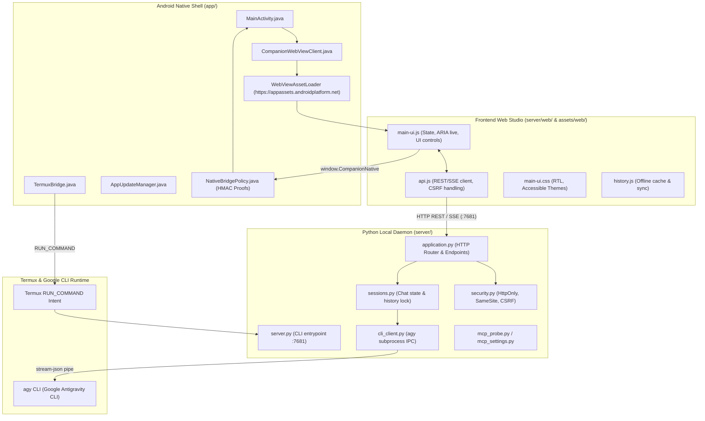

# Antigravity Companion: Codebase Architecture Map & Surgical Navigation Guide

> **Single Source of Truth**: This document maps 100% of the `antigravity-companion-app` codebase. Before touching any file, read this map to identify exact symbols, boundaries, and prescriptive modification recipes.

---

## 1. System Topology & Cross-Layer Data Flow

`Antigravity Companion` is a multi-tier hybrid application that bridges an Android native shell and accessible Web Studio to the local Google Antigravity CLI (`agy`) running in Termux.

### Architectural Diagram

### Core Communication Sequences

#### 1. Server Launch Sequence
1. **Trigger**: User opens Android App or taps "Start Server" toggle.
2. **Inspection**: `DoctorDiagnosticEngine.java` checks:
   - Is Termux installed (`com.termux`)?
   - Is `com.termux.permission.RUN_COMMAND` granted?
   - Is port `7681` already responding (`ServerConnection.java`)?
3. **Dispatch**: If not running, `TermuxBridge.java` sends a `RUN_COMMAND` intent to execute `server/launch_server.sh`.
4. **Daemonization**: `launch_server.sh` spawns `server/server.py --port 7681 --data-dir ~/.antigravity-companion` in the background and writes PID to `.server.pid`.
5. **Readiness Probe**: `MainActivity` polls `http://127.0.0.1:7681/api/status` until HTTP 200 is confirmed, then switches UI state to `ONLINE`.

#### 2. Chat Turn & Token Streaming Sequence
1. **User Input**: User submits a message via Web Studio (`main-ui.js`).
2. **REST Dispatch**: `api.js` issues `POST /api/chat` with JSON payload `{sessionId, prompt, model, reasoningEffort}`.
3. **Security Gate**: `security.py` verifies CSRF token, Session Cookie (`HttpOnly; SameSite=Strict`), and local `Origin` / `Host` headers.
4. **Session Lock**: `sessions.py` acquires the turn lock for the active session and appends the user turn.
5. **CLI Worker**: `cli_client.py` constructs flags and invokes `agy --print` or pipes to a warm stream-json subprocess.
6. **Streaming Egress**: Server streams Server-Sent Events (`text/event-stream`) back to `api.js`.
7. **Screen Reader Announcement**: `main-ui.js` updates live regions (`aria-live="polite"`), triggers WebAudio chimes, and handles speech synthesis if enabled.

#### 3. Native Bridge Security Protocol
- JavaScript invokes Android methods via `window.CompanionNative`.
- **HMAC Proof Guard**: Sensitive native calls (e.g., launching Termux commands, reading system state) require an HMAC proof generated using `NativeSecrets.java` and verified by `NativeBridgePolicy.java`.
- Prevents malicious external websites from triggering native actions if loaded in the WebView.

---

## 2. Component Breakdown & Responsibilities

The codebase is strictly segregated into 4 isolated tiers:

### Tier 1: Android Native Shell (`app/`)
* **Role**: Lightweight Android host providing the system container, WebView, Termux launcher, accessibility services integration, and background OTA updates.
* **Core Language**: Java 17 / Android SDK 34.
* **Package**: `com.antigravity.companion`.
* **Invariants**:
  - Zero heavy business logic; delegates AI and API orchestration to the Python server.
  - Strict Origin policies: only loads assets from `https://appassets.androidplatform.net/` or localhost `127.0.0.1:7681`.

### Tier 2: Python Backend Local Server (`server/`)
* **Role**: Local REST API and SSE streaming server running inside Termux.
* **Core Language**: Python 3.10+ (standard library `http.server` & lightweight concurrency).
* **Port**: `7681` (default).
* **Invariants**:
  - Bound exclusively to `127.0.0.1` (never exposed to public interfaces).
  - All state stored in local JSON/SQLite files under `--data-dir` (default: `~/.antigravity-companion`). Zero cloud database dependencies.

### Tier 3: Frontend Web Studio (`server/web/` & `app/src/main/assets/web/`)
* **Role**: Responsive, accessible Arabic RTL chat interface and diagnostics dashboard.
* **Core Tech**: Vanilla JavaScript (ES2022), CSS3, Semantic HTML5, Service Worker.
* **Invariants**:
  - **Dual-Copy Asset Invariant**: Canonical assets live in `server/web/`. Any changes MUST be mirrored to `app/src/main/assets/web/` using `python scripts/sync_android_web.py`.
  - Accessible to screen readers (TalkBack / Jieshuo): ARIA labels, semantic roles, high-contrast themes.

### Tier 4: Tooling, Packaging & Test Automation (`scripts/`)
* **Role**: Automated regression suites, release packaging, cryptographic signing, and environment preflight checks.
* **Core Language**: Python standard library (`unittest`), Bash, Java (ReleaseSigner).
