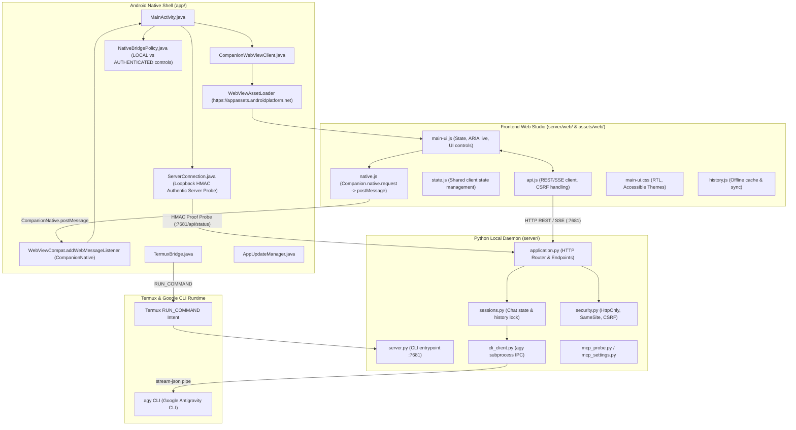

# Antigravity Companion: Codebase Architecture Map & Surgical Navigation Guide

> **Single Source of Truth**: This document maps 100% of the `antigravity-companion-app` codebase. Before touching any file, read this map to identify exact symbols, boundaries, and prescriptive modification recipes.

---

## 1. System Topology & Cross-Layer Data Flow

`Antigravity Companion` is a multi-tier hybrid application that bridges an Android native shell and accessible Web Studio to the local Google Antigravity CLI (`agy`) running in Termux.

### Architectural Diagram



### Core Communication Sequences

#### 1. Server Launch Sequence
1. **Trigger**: User opens Android App or taps "Start Server" toggle.
2. **Inspection**: `DoctorDiagnosticEngine.java` checks:
   - Is Termux installed (`com.termux`)?
   - Is `com.termux.permission.RUN_COMMAND` granted?
   - Is port `7681` already responding (`ServerConnection.java`)?
3. **Dispatch**: If not running, `TermuxBridge.java` sends a `RUN_COMMAND` intent to execute `server/launch_server.sh`.
4. **Daemonization**: `launch_server.sh` spawns `server/server.py --port 7681 --data-dir ~/.antigravity-companion` in the background and writes PID to `.server.pid`.
5. **Readiness & Auto-Trust Probe**: `ServerConnection.java` probes `http://127.0.0.1:7681/health`. If available, it executes `authenticServer()` to verify loopback service readiness, bootstraps the session cookie automatically via loopback auto-trust, and flags `serverConnected = true`.
6. **UI Transition**: `MainActivity` switches UI state to `ONLINE` and reports status to screen readers.

#### 2. Chat Turn & Token Streaming Sequence
1. **User Input**: User submits a message via Web Studio (`main-ui.js`).
2. **REST Dispatch**: `api.js` issues `POST /api/chat` with JSON payload `{sessionId, prompt, model, reasoningEffort}`.
3. **Security Gate**: `security.py` verifies CSRF token, Session Cookie (`HttpOnly; SameSite=Strict`), and local `Origin` / `Host` headers.
4. **Session Lock**: `sessions.py` acquires the turn lock for the active session and appends the user turn.
5. **CLI Worker**: `cli_client.py` constructs flags and invokes `agy --print` or pipes to a warm stream-json subprocess.
6. **Streaming Egress**: Server streams Server-Sent Events (`text/event-stream`) back to `api.js`.
7. **Screen Reader Announcement**: `main-ui.js` updates live regions (`aria-live="polite"`), triggers WebAudio chimes, and handles speech synthesis if enabled.

#### 3. Native Web Message Bridge Protocol
- Modern Web-to-Native communication uses AndroidX `WebViewCompat.addWebMessageListener` bound to channel `"CompanionNative"`.
- **Client Dispatch**: JavaScript in `server/web/native.js` invokes `Companion.native.request(action, args)`, generating a UUID `request_id` and calling `window.CompanionNative.postMessage(JSON.stringify({request_id, action, args}))`.
- **Android Ingestion**: `MainActivity.java` receives the message in `receiveNativeRequest(message)`:
  1. Validates payload JSON structure and `request_id` regex.
  2. Evaluates `NativeBridgePolicy.allows(actionName, serverConnected, isDashboard)`.
  3. Validates action parameters with `NativeActionArguments.validate(actionName, request.args)`.
  4. Dispatches to the registered handler in `actions.get(actionName)`.
  5. Emits `companion-native-result` event back to the WebView with `{request_id, success, result/error}`.

---

## 2. Component Breakdown & Responsibilities

The codebase is strictly segregated into 4 isolated tiers:

### Tier 1: Android Native Shell (`app/`)
* **Role**: Lightweight Android host providing the system container, WebView, Termux launcher, accessibility services integration, and background OTA updates.
* **Core Language**: Java 17 / Android SDK 34.
* **Package**: `com.antigravity.companion`.
* **Invariants**:
  - Zero heavy business logic; delegates AI and API orchestration to the Python server.
  - Strict Origin policies: only loads assets from `https://appassets.androidplatform.net/` or localhost `127.0.0.1:7681`.

### Tier 2: Python Backend Local Server (`server/`)
* **Role**: Local REST API and SSE streaming server running inside Termux.
* **Core Language**: Python 3.10+ (standard library `http.server` & lightweight concurrency).
* **Port**: `7681` (default).
* **Invariants**:
  - Bound exclusively to `127.0.0.1` (never exposed to public interfaces).
  - All state stored in local JSON/SQLite files under `--data-dir` (default: `~/.antigravity-companion`). Zero cloud database dependencies.

### Tier 3: Frontend Web Studio (`server/web/` & `app/src/main/assets/web/`)
* **Role**: Responsive, accessible Arabic RTL chat interface and diagnostics dashboard.
* **Core Tech**: Vanilla JavaScript (ES2022), CSS3, Semantic HTML5, Service Worker.
* **Invariants**:
  - **Dual-Copy Asset Invariant**: Canonical assets live in `server/web/`. Any changes MUST be mirrored to `app/src/main/assets/web/` using `python scripts/sync_android_web.py`.
  - Accessible to screen readers (TalkBack / Jieshuo): ARIA labels, semantic roles, high-contrast themes.

### Tier 4: Tooling, Packaging & Test Automation (`scripts/`)
* **Role**: Automated regression suites, release packaging, cryptographic signing, and environment preflight checks.
* **Core Language**: Python standard library (`unittest`), Bash, Java (ReleaseSigner).

---

## 3. File-by-File Matrix (Complete Inventory)

This matrix catalogs all production source files, their primary responsibilities, core exported symbols, and bidirectional dependencies.

### 3.1. Android Native Layer (`app/src/main/java/com/antigravity/companion/`)

| File | Core Responsibilities & Symbols | Dependencies In / Calling | Dependencies Out / Called By |
|---|---|---|---|
| `MainActivity.java` | Main Android Activity; manages lifecycle, initializes WebView, sets up `WebViewCompat.addWebMessageListener` on channel `CompanionNative`, registers native actions (`actions.put`), triggers background updates. Key symbols: `onCreate()`, `setupWebView()`, `receiveNativeRequest()`, `checkAppUpdates()`, `actions`. | Android OS, `CompanionWebViewClient`, `TermuxBridge`, `AppUpdateManager`, `NativeBridgePolicy`, `NativeActionArguments` | System launch intent |
| `CompanionWebViewClient.java` | Custom `WebViewClient` using `WebViewAssetLoader` to serve bundled assets securely; intercepts internal links, enforces origin validation. Key symbols: `shouldInterceptRequest()`, `shouldOverrideUrlLoading()`. | `OriginPolicy`, `WebViewAssetLoader` | `MainActivity` |
| `TermuxBridge.java` | Dispatches execution intents to Termux using `com.termux.RUN_COMMAND`; handles permission verification, background execution results, and socket probes. Key symbols: `launchServerIntent()`, `isTermuxInstalled()`, `hasRunCommandPermission()`. | `TermuxLaunchContract`, Android `Intent` | `MainActivity`, `DoctorDiagnosticEngine` |
| `DoctorDiagnosticEngine.java` | Performs comprehensive on-device health checks (Termux presence, RUN_COMMAND permission, local server responsiveness, battery optimization). Key symbols: `runAllDiagnostics()`, `DiagnosticResult`, `checkServerConnection()`. | `TermuxBridge`, `ServerConnection` | `MainActivity` |
| `AppUpdateManager.java` | Manages in-app OTA updates via GitHub Releases; checks version codes, downloads update APK via `UpdateTransfer`, validates checksums, triggers package installer. Key symbols: `checkForUpdate()`, `downloadAndInstall()`, `ReleaseInfo`. | `UpdatePolicy`, `UpdateCompatibility`, `UpdateTransfer` | `MainActivity` |
| `NativeBridgePolicy.java` | Policy authorization engine for Web-to-Native calls; categorizes actions into `LOCAL_CONTROLS` (executable offline) vs `AUTHENTICATED_CONTROLS` (requires authenticated server connection). Key symbols: `allows(action, authenticated, localPage)`, `LOCAL_CONTROLS`, `AUTHENTICATED_CONTROLS`. | `Set<String>` | `MainActivity` (`receiveNativeRequest`) |
| `OriginPolicy.java` | Verifies allowed web origins (restricts to `https://appassets.androidplatform.net` and `http://127.0.0.1:7681`). Key symbols: `isAllowedOrigin()`, `allowsNativeOrigin()`, `allowsNativePage()`, `ASSET_ORIGIN`, `DASHBOARD_URL`. | Android Uri | `CompanionWebViewClient`, `MainActivity` |
| `NativeSecrets.java` | Manages cryptographic session tokens and keystore-derived keys used by `ServerConnection` to authenticate the local Python server. Key symbols: `sessionSecret()`, `localOriginSecret()`. | Android Keystore | `ServerConnection`, `NativeProof` |
| `NativeRequestLedger.java` | Replay protection ledger; records nonce timestamps and reserves active request IDs to prevent replay of native calls. Key symbols: `reserve()`, `contains()`, `evictExpired()`. | Java Collections | `MainActivity` |
| `NativeProof.java` | Computes and validates HMAC-SHA256 signatures passed during server-to-Android authentication probes. Key symbols: `verifyProof()`, `computeProof()`. | `NativeSecrets`, `javax.crypto.Mac` | `ServerConnection` |
| `NativeActionArguments.java` | Deserializes and validates JSON arguments passed from JavaScript to native methods. Key symbols: `validate()`, `required()`, `optional()`. | `com.google.gson.JsonObject` | `MainActivity` |
| `ServerConnection.java` | HTTP ping and HMAC authentication client checking local server health on `127.0.0.1:7681/api/status`. Key symbols: `probe()`, `authenticServer()`, `bootstrapCookie()`. | `java.net.HttpURLConnection`, `NativeSecrets`, `NativeProof` | `DoctorDiagnosticEngine`, `MainActivity` |
| `TermuxLaunchContract.java` | Constant definitions and intent action/extra contracts for interacting with Termux. Key symbols: `ACTION_EXECUTE`, `EXTRA_COMMAND_PATH`, `EXTRA_ARGUMENTS`. | None | `TermuxBridge` |
| `UpdatePolicy.java` | Business rules determining whether a discovered GitHub release is compatible and eligible for auto-install. Key symbols: `shouldPromptUpdate()`, `isDowngradeProhibited()`. | `UpdateCompatibility` | `AppUpdateManager` |
| `UpdateCompatibility.java` | Checks Android SDK version compatibility and CPU architecture (arm64-v8a vs universal) for download candidate. Key symbols: `isCompatible()`, `getSupportedAbis()`. | Android `Build` | `UpdatePolicy`, `AppUpdateManager` |
| `UpdateTransfer.java` | File downloader streaming update APK bytes to isolated app storage with SHA256 verification. Key symbols: `downloadFile()`, `verifyChecksum()`. | `java.net.URL`, `java.security.MessageDigest` | `AppUpdateManager` |
| `BootReceiver.java` | Android BroadcastReceiver listening for `ACTION_BOOT_COMPLETED` to trigger optional background companion services. Key symbols: `onReceive()`, `recovered()`. | Android `BroadcastReceiver` | Android OS |
| `ServerDeployer.java` | Exports offline server package as `companion-server-update.zip` to public Downloads folder with MediaStore support for Android 11+. Key symbols: `exportServerBundle()`, `BUNDLE_ZIP_NAME`, `zipAssetFolder()`. | `MediaStore`, `ZipOutputStream` | `MainActivity` |

---

### 3.2. Python Backend Server (`server/`)

| File | Core Responsibilities & Symbols | Dependencies In / Calling | Dependencies Out / Called By |
|---|---|---|---|
| `server.py` | CLI entry point and process lifecycle manager; parses `--host`, `--port`, `--data-dir`, binds HTTP server. Key symbols: `main()`, `run_server()`, `parse_args()`. | `application.py`, `launcher.py` | Shell / Termux `launch_server.sh` |
| `auth_flow.py` | Inspects and decodes Google Antigravity OAuth session tokens (`~/.gemini/antigravity-cli/antigravity-oauth-token`); checks email, expiration timestamp, and login validity. Key symbols: `get_oauth_token_info()`, `NAME`, `AUTH_TOKEN_FILE`. | `base64`, `json`, `pathlib` | `application.py` |
| `application.py` | Primary HTTP request router and endpoint controller; handles `/api/status`, `/api/chat`, `/api/sessions`, `/api/mcp`, `/api/doctor`, `/api/shutdown`. Key symbols: `CompanionRequestHandler`, `handle_chat()`, `handle_status()`, `dispatch_route()`. | `security.py`, `sessions.py`, `cli_client.py`, `runtime_status.py`, `mcp_probe.py`, `auth_flow.py` | `server.py` |
| `sessions.py` | Session management and state persistence; maintains chat conversation trees, history saves, and turn serialization locks. Key symbols: `SessionStore`, `get_session()`, `create_session()`, `append_turn()`, `acquire_turn_lock()`. | `storage.py`, `cli_client.py` | `application.py` |
| `cli_client.py` | Subprocess bridge and IPC coordinator to the Google `agy` CLI; formats model flags, reasoning effort, and stream-json pipes. Key symbols: `AgyCliClient`, `run_prompt_streaming()`, `discover_cli_path()`, `spawn_worker()`. | `cli_catalog.py`, `subprocess` | `sessions.py`, `application.py` |
| `cli_catalog.py` | Catalog of available Gemini models, alias mappings, reasoning capability flags, and default system instructions. Key symbols: `MODEL_CATALOG`, `resolve_model_alias()`, `get_model_capabilities()`. | None | `cli_client.py`, `cli_settings.py` |
| `cli_settings.py` | Reads and persists CLI user preferences, selected models, reasoning presets in `~/.antigravity-companion/settings.json`. Key symbols: `SettingsManager`, `load_settings()`, `save_settings()`. | `storage.py` | `application.py`, `cli_client.py` |
| `mcp_probe.py` | Dynamic discovery engine that inspects configured Model Context Protocol (MCP) servers and tools in `~/.gemini/antigravity-cli/mcp`. Key symbols: `probe_mcp_servers()`, `list_available_tools()`. | `pathlib`, `json` | `application.py`, `mcp_settings.py` |
| `mcp_settings.py` | Manages MCP tool enablement, server overrides, and authorization scopes. Key symbols: `get_mcp_config()`, `toggle_mcp_server()`. | `storage.py` | `application.py` |
| `runtime_status.py` | Gathers real-time server metrics (RAM usage, active sessions, child process health, Termux environment details). Key symbols: `get_runtime_status()`, `gather_system_metrics()`. | `psutil` (optional), `os`, `sys` | `application.py` |
| `security.py` | HTTP security boundaries; generates/verifies CSRF tokens, sets `HttpOnly; SameSite=Strict` cookies, validates Origin/Host headers. Key symbols: `verify_csrf_token()`, `generate_csrf_token()`, `validate_origin()`, `create_session_cookie()`. | `hmac`, `secrets`, `hashlib` | `application.py` |
| `storage.py` | Thread-safe file system storage helper; handles atomic JSON writes, schema migrations, and backup rotation under data-dir. Key symbols: `read_json()`, `write_json_atomic()`, `ensure_data_dirs()`. | `pathlib`, `tempfile` | `sessions.py`, `cli_settings.py` |
| `launcher.py` | Background process daemonizer and PID file manager; supports start, stop, status checks from CLI. Key symbols: `start_daemon()`, `stop_daemon()`, `is_running()`, `read_pid()`. | `os`, `signal` | `server.py`, `launch_server.sh` |
| `local_tasks.py` | In-memory job coordinator for long-running background tasks (e.g., deep transcript downloads, batch exports). Key symbols: `TaskManager`, `enqueue_task()`, `get_task_status()`. | `threading`, `queue` | `application.py`, `task_runtime.py` |
| `task_runtime.py` | Execution sandbox for local background tasks with timeout guards and cancellation signals. Key symbols: `TaskWorker`, `execute_with_timeout()`. | `local_tasks.py` | `application.py` |
| `voice_agent.py` | Voice session orchestrator coordinating speech recognition and text-to-speech synthesis pipelines. Key symbols: `VoiceAgent`, `process_voice_turn()`. | `voice_planner.py` | `application.py` |
| `voice_planner.py` | Natural language intent parser for voice commands (e.g. "open chat", "start diagnostic", "read screen"). Key symbols: `VoicePlanner`, `plan_action()`. | `re`, `json` | `voice_agent.py` |
| `android_client.py` | Direct Termux-to-Android helper; executes `am start` and Android broadcast commands if Termux:API is present. Key symbols: `send_broadcast()`, `launch_activity()`. | `subprocess` | `application.py` |
| `legacy_conversations.py` | Data migration adapter converting legacy JSON chat history into the modern session format. Key symbols: `import_legacy_chats()`, `adapt_history_schema()`. | `storage.py` | `sessions.py` |
| `conversation_metadata.py` | Metadata persistence store for conversation titles, pinning state, and soft deletion. Key symbols: `ConversationMetadataStore`, `update()`, `mark_deleted()`. | `storage.py`, `json` | `legacy_conversations.py`, `application.py` |
| `version.json` | JSON metadata defining current server release name, semantic version, build timestamp, and Git commit SHA. | Read by `application.py` | Diagnostic endpoints |
| `launch_server.sh` | Shell script launching the daemonized Python server in Termux; redirects logs to `~/.antigravity-companion/server.log`. | Spawns `server.py` | Termux `RUN_COMMAND` |
| `stop_server.sh` | Shell script stopping the running daemon by sending `SIGTERM` to the PID recorded in `.server.pid`. | Uses `kill` | Termux `RUN_COMMAND`, `MainActivity` |

---

### 3.3. Frontend Web Studio (`server/web/` & `app/src/main/assets/web/`)

> [!IMPORTANT]
> **Dual-Copy Invariant**: `server/web/` is the canonical source. Whenever any file here is modified, you MUST run `python scripts/sync_android_web.py` to copy changes into `app/src/main/assets/web/`.

| File | Core Responsibilities & Symbols | Interacting Files |
|---|---|---|
| `index.html` | Core responsive single-page interface; contains chat message stream, prompt textarea, reasoning effort toggles, model selector, diagnostic drawer, and ARIA live regions for screen readers. | `main-ui.css`, `main-ui.js`, `api.js`, `native.js`, `state.js` |
| `start.html` | First-run / fallback onboarding page displayed when server is offline or initializing. | `start-ui.css`, `start-ui.js`, `native.js` |
| `main-ui.js` | UI state controller; manages message DOM rendering, markdown formatting, auto-scrolling, accessibility focus traps, keyboard shortcuts (`Ctrl+Enter`), and WebAudio feedback. | `index.html`, `api.js`, `history.js`, `state.js` |
| `main-ui.css` | Accessible CSS design system; RTL layouts, high contrast dark/light themes, WCAG AA compliant contrast ratios, fluid responsiveness. | `index.html` |
| `native.js` | Modern native bridge client; encapsulates `Companion.native.request(action, args)` using AndroidX WebMessage listener (`CompanionNative.postMessage`). | `index.html`, `start.html`, `main-ui.js`, `MainActivity.java` |
| `state.js` | Shared frontend reactive state container; manages active session metadata, model presets, and UI connection flags. | `main-ui.js`, `api.js` |
| `main-v1-adapter.js` | Compatibility adapter bridging legacy v1 chat endpoints with the modern streaming API. | `main-ui.js`, `api.js` |
| `start-ui.js` | First-run setup and diagnostics controller for `start.html`; coordinates Termux installation checks and server boot. | `start.html`, `native.js` |
| `start-ui.css` | Dedicated styles for the first-run / offline setup onboarding screen. | `start.html` |
| `api.js` | Asynchronous REST and SSE client; manages HTTP session tokens, CSRF handshakes, message chunk parsing, and reconnection retries. Key symbols: `sendMessageStream()`, `fetchStatus()`, `fetchSessions()`. | `main-ui.js`, Backend `application.py` |
| `history.js` | Client-side IndexedDB / LocalStorage cache for offline conversation browsing and search. | `main-ui.js` |
| `legacy-native.js` | Backward-compatibility shim providing fallback JS bridge functions for older WebViews. | `start.html`, `MainActivity.java` |
| `styles.css` | Base utility stylesheet and typographic resets. | `index.html`, `start.html` |
| `ui.js` | Common modal dialogs, accessible alert banners, and focus restoration helpers. | `main-ui.js`, `start-ui.js` |
| `manifest.json` | Progressive Web App (PWA) manifest; defines theme colors, app icons, and standalone display mode. | Browser / WebView |
| `sw.js` | Service Worker; caches static shell assets (`css`, `js`, `svg`) while bypassing API endpoints (`/api/*`). | Browser / PWA runtime |
| `icon.svg` | Scalable vector logo for Antigravity Companion. | `manifest.json`, `index.html` |
| `run_features_tests.cjs` | Web unit test runner validating message streaming and prompt dispatch. | Node.js test harness |
| `run_legacy_native_tests.cjs` | Test suite validating legacy bridge compatibility and fallback behavior. | Node.js test harness |
| `run_main_ui_tests.cjs` | Headless DOM tests for UI element binding, ARIA updates, and chat rendering. | Node.js test harness |
| `run_mentions_tests.cjs` | Tests parsing of @-mentions and tool scoping in the prompt textarea. | Node.js test harness |
| `run_tests.cjs` | Master Node.js runner executing all client-side unit test suites. | Web CI / Node.js |
| `run_ui_tests.cjs` | Tests for UI interaction states, dark mode toggle, and settings panel. | Node.js test harness |
| `vendor/` | Directory containing vendored libraries: `alpine-csp.min.js`, `marked.umd.js`, `purify.min.js`, `tailwind.min.css`. | `index.html` |

---

### 3.4. Tooling, Packaging & Test Automation (`scripts/`)

| File | Purpose and Core Symbols | Invariants & Test Coverage |
|---|---|---|
| `doctor.py` | CLI diagnostic utility (`python scripts/doctor.py --doctor`); inspects Python, Termux environment, `agy` on PATH, server status. | Read-only inspection; run anytime. |
| `sync_android_web.py` | Canonical asset synchronizer (`python scripts/sync_android_web.py [--check]`); copies `server/web/` to `app/src/main/assets/web/` and verifies MD5 parity. | Essential pre-commit check. |
| `sync_server_assets.py` | Synchronizes canonical server and web runtime assets to Android APK assets and Termux directory. | Used by update and deployment pipeline. |
| `prepare_web_release.py` | Updates cache version hashes inside `sw.js` before release builds. | Run before packaging releases. |
| `package_release.py` | Builds signed production Termux ZIP packages with cryptographic signatures. | Requires release keys. |
| `install_release.py` | Verifies and selects Termux package releases atomically with rollback protection. | Used by update orchestrator. |
| `ReleaseSigner.java` | Java cryptographic utility for RSA/ECDSA signing of release manifests. | Run via JDK. |
| `phase1_preflight.py` | Preflight suite testing CLI `--help` flags, argument parsing, and local HTTP endpoint readiness. | Required CI/Preflight gate. |
| `phone_acceptance.py` | On-device chat API and screen reader automation acceptance harness. | Requires device or emulator. |
| `run_tests.py` | Main test runner discovering all unit and integration suites under `scripts/`. | Python standard `unittest`. |
| `run_backend_tests.py` | Comprehensive test suite for `application.py`, `sessions.py`, `security.py`, and `storage.py`. | 60+ test cases. |
| `run_android_web_asset_tests.py` | Validates parity between canonical web assets and Android bundled assets. | Checks MD5 hashes. |
| `run_auth_tests.py` | Tests CSRF validation, session cookie handling, and Origin policy enforcement. | Security gate. |
| `run_feature_tests.py` | End-to-end chat turn and SSE streaming tests against mock CLI runners. | Feature gate. |
| `run_launcher_tests.py` | Tests PID file management, daemon spawning, and signal handling. | Process management. |
| `run_mcp_scope_tests.py` | Tests MCP server discovery, schema extraction, and tool execution scopes. | MCP integration. |
| `run_pairing_tests.py` | Tests device pairing and authentication handshakes. | Security test suite. |
| `run_parity_tests.py` | Regression tests checking behavioral parity between local and remote models. | Parity verification. |
| `run_phone_harness_tests.py` | Unit tests for the phone acceptance testing harness itself. | Testing tooling. |
| `run_phone_tests.py` | Host ADB acceptance test runner for Android device interaction. | ADB automation. |
| `run_planner_tests.py` | Tests for intent parsing and voice command planners. | Planner validation. |
| `run_process_tests.py` | Process isolation, child killing, and zombie prevention tests. | Concurrency security. |
| `run_release_tests.py` | Cryptographic signature and packaging verification tests. | Release gate. |
| `run_schedule_tests.py` | Tests for recurring cron schedules and background task timers. | Task scheduling. |
| `run_settings_panel_tests.py` | Tests for reading/writing configuration values and schema defaults. | Settings persistence. |
| `run_shutdown_tests.py` | Tests graceful daemon termination and resource cleanup. | Server lifecycle. |
| `run_stream_retry_tests.js` | SSE streaming reconnection and retry behavior test suite. | Node.js streaming tests. |
| `run_task_tests.py` | Tests background task queueing, execution, and cancellation. | Task runner suite. |
| `run_tts_tests.py` | Tests WebAudio synthesis and speech playback integrations. | Accessibility audio. |
| `run_voice_tests.py` | End-to-end speech recognition and voice loop tests. | Voice agent suite. |
| `test_code_map_integrity.py` | Automated integrity test for `CODE_MAP.md`; verifies sections, recipes, and 100% dynamic file indexing. | Self-referential test gate. |
| `test_conversation_metadata.py` | Unit tests for conversation metadata persistence and pinning. | Metadata test suite. |
| `test_conversation_resilience_and_management.py` | Integration tests for conversation management and tool telemetry resilience. | Resilience test suite. |
| `test_legacy_conversations_tools.py` | Tests for tool parsing and status extraction from transcripts. | Transcript parsing suite. |
| `test_streaming_resilience.py` | Unit tests for stream recovery and retry without error alerts. | Streaming resilience suite. |

#### Android Native Unit Tests (`app/src/test/java/com/antigravity/companion/`)
- `DoctorDiagnosticEngineTest.java`: Tests Termux detection and diagnostic rules.
- `NativeActionArgumentsTest.java`: Tests argument schema validation.
- `NativeBridgePolicyTest.java`: Tests `LOCAL_CONTROLS` and `AUTHENTICATED_CONTROLS` permission boundaries.
- `NativeProofTest.java`: Tests HMAC-SHA256 verification.
- `NativeRequestLedgerTest.java`: Tests request ID deduplication and replay prevention.
- `OriginPolicyTest.java`: Tests origin URL matching and sanitization.
- `ServerConnectionTest.java`: Tests loopback probing and status reporting.
- `TermuxLaunchContractTest.java`: Tests intent extras and action constants.
- `UpdateCompatibilityTest.java`: Tests architecture and ABI matching for APK updates.
- `UpdatePolicyTest.java`: Tests update prompts and downgrade prevention.
- `UpdateTransferTest.java`: Tests SHA256 checksum verification during download.

---

## 4. Surgical Modification Playbooks

Use these 8 prescriptive recipes whenever implementing features or fixing bugs. Follow each step in order; do not guess or edit files outside the recipe.

### Recipe A: Adding or Modifying a Backend REST API Endpoint

* **Goal**: Expose a new HTTP route (e.g., `/api/new-feature`) or change an existing response schema.
* **Files to Modify**:
  1. `server/application.py` — Add route dispatch in `do_GET()` / `do_POST()` and write the handler method `handle_new_feature()`.
  2. `server/security.py` — If state-changing (POST/PUT/DELETE), add CSRF token validation and session cookie verification.
  3. `server/web/api.js` — Add the client-side async fetch wrapper.
* **Files to NEVER Touch**:
  - `server/server.py` (CLI entry point, socket binding only).
  - `app/src/main/java/com/antigravity/companion/MainActivity.java` (Android shell does not route HTTP).
* **Step-by-Step Procedure**:
  1. Define path constant and parameter validation in `server/application.py`.
  2. If the endpoint requires persistence, delegate storage logic to `server/storage.py` or `server/sessions.py`.
  3. Implement JSON response serialization using `self._send_json(data, status=200)`.
  4. Update client fetch helper in `server/web/api.js`.
  5. Synchronize web assets: `python3 scripts/sync_android_web.py`.
  6. Write unit test in `scripts/run_backend_tests.py`.
* **Verification Command**:
  ```bash
  python3 scripts/sync_android_web.py --check && python3 scripts/run_backend_tests.py -v
  ```

---

### Recipe B: Updating Web UI Layout or Chat Interactions

* **Goal**: Modify UI styling, add buttons, adjust RTL layout, or change markdown rendering.
* **Files to Modify**:
  1. `server/web/index.html` (Markup, ARIA live regions, semantic buttons).
  2. `server/web/main-ui.css` (Styles, RTL rules, WCAG color contrast).
  3. `server/web/main-ui.js` (DOM event listeners, screen reader announcements).
  4. `server/web/state.js` (If modifying UI reactive state).
* **Files to NEVER Touch**:
  - Direct edits to `app/src/main/assets/web/*` (WILL BE OVERWRITTEN by sync script).
* **Step-by-Step Procedure**:
  1. Make edits ONLY inside `server/web/`.
  2. Test in local browser or run preflight checks.
  3. Run the canonical synchronization tool:
     ```bash
     python3 scripts/sync_android_web.py
     ```
  4. Verify MD5 asset parity:
     ```bash
     python3 scripts/sync_android_web.py --check
     ```
* **Verification Command**:
  ```bash
  python3 scripts/sync_android_web.py --check && python3 scripts/run_android_web_asset_tests.py
  ```

---

### Recipe C: Adding a New Android Native Bridge Method

* **Goal**: Allow Web JavaScript to call a new Android system action via `window.CompanionNative`.
* **Files to Modify**:
  1. `app/src/main/java/com/antigravity/companion/MainActivity.java` — Register the new action in `actions.put("action_name", request -> handleAction(request))`.
  2. `app/src/main/java/com/antigravity/companion/NativeBridgePolicy.java` — Add `"action_name"` to `LOCAL_CONTROLS` (if safe offline) or `AUTHENTICATED_CONTROLS` (if requiring an authentic server).
  3. `app/src/main/java/com/antigravity/companion/NativeActionArguments.java` — Add argument validation schema in `validate()`.
  4. `server/web/native.js` — Expose JS helper `Companion.native.action_name = (args) => Companion.native.request('action_name', args)`.
* **Files to NEVER Touch**:
  - `app/src/main/java/com/antigravity/companion/OriginPolicy.java` (Do not weaken origin restrictions).
* **Step-by-Step Procedure**:
  1. Register action name in `NativeBridgePolicy.java` under appropriate set (`LOCAL_CONTROLS` or `AUTHENTICATED_CONTROLS`).
  2. Add argument validation rules in `NativeActionArguments.java`.
  3. Implement action handler in `MainActivity.java`:
     ```java
     actions.put("action_name", request -> {
         // Perform native work
         reply(request, resultObject);
     });
     ```
  4. Add JS dispatch wrapper in `server/web/native.js` using `Companion.native.request("action_name", args)`.
  5. Sync web assets: `python3 scripts/sync_android_web.py`.
* **Verification Command**:
  ```bash
  python3 scripts/sync_android_web.py --check && python3 scripts/run_android_web_asset_tests.py
  ```

---

### Recipe D: Adjusting agy CLI Interaction Flags or Model Catalogue

* **Goal**: Add a new Gemini model, change reasoning effort levels, or update CLI subprocess flags.
* **Files to Modify**:
  1. `server/cli_catalog.py` — Add model name, alias, and capability flags to `MODEL_CATALOG`.
  2. `server/cli_client.py` — Update CLI argument construction in `build_cli_args()`.
  3. `server/cli_settings.py` — Update validation rules for user settings.
  4. `server/web/main-ui.js` — Add model option to `<select id="model-select">`.
* **Files to NEVER Touch**:
  - Subprocess spawn safety: Never use `shell=True`. Always pass argument lists.
* **Step-by-Step Procedure**:
  1. Add model entry to `cli_catalog.py`.
  2. Update CLI flag builder in `cli_client.py`.
  3. Update UI select element and run `python3 scripts/sync_android_web.py`.
* **Verification Command**:
  ```bash
  python3 scripts/run_feature_tests.py -v
  ```

---

### Recipe E: Modifying Termux Diagnostic Checks

* **Goal**: Add or adjust diagnostic checks (e.g., verifying a new package or socket).
* **Files to Modify**:
  1. `scripts/doctor.py` — Add CLI diagnostic function `check_new_requirement()`.
  2. `app/src/main/java/com/antigravity/companion/DoctorDiagnosticEngine.java` — Add on-device check.
  3. `server/runtime_status.py` — Expose status in `/api/doctor`.
* **Files to NEVER Touch**:
  - `server/server.py`.
* **Step-by-Step Procedure**:
  1. Implement diagnostic check in `scripts/doctor.py`.
  2. Mirror check in `DoctorDiagnosticEngine.java` with localized Arabic description in `strings.xml`.
  3. Test CLI output:
     ```bash
     python3 scripts/doctor.py --doctor
     ```
* **Verification Command**:
  ```bash
  python3 scripts/doctor.py --doctor
  ```

---

### Recipe F: Updating and Publishing an In-App OTA Release

* **Goal**: Cut a new release of Antigravity Companion so existing app installations auto-update.
* **Files to Modify**:
  1. `app/build.gradle` — Increment `versionCode` and update `versionName`.
  2. `.github/workflows/build-apk.yml` — Update release tag / version environment.
  3. `project_spec.json` — Update `"version"`.
  4. `server/version.json` — Update server release version and build date.
* **Files to NEVER Touch**:
  - `app/keystore/antigravity-release-key.jks` (Permanent release key).
* **Step-by-Step Procedure**:
  1. Sync web assets: `python3 scripts/sync_android_web.py`.
  2. Verify all tests pass: `python3 scripts/run_backend_tests.py`.
  3. Commit and tag:
     ```bash
     git commit -am "release: vX.Y.Z"
     git tag vX.Y.Z
     git push origin main --tags
     ```
  4. GitHub Actions builds and signs APK; `AppUpdateManager.java` detects the release via GitHub API.
* **Verification Command**:
  ```bash
  python3 scripts/phase1_preflight.py
  ```

---

### Recipe G: Adding a New Backend Unit Test

* **Goal**: Write regression tests for a newly introduced server feature or bugfix.
* **Files to Modify**:
  1. `scripts/run_backend_tests.py` (or create dedicated `scripts/run_<feature>_tests.py`).
  2. `scripts/run_tests.py` (if creating a new test module, add to test loader).
* **Files to NEVER Touch**:
  - Production code inside `server/` (tests must only test behavior, not modify it).
* **Step-by-Step Procedure**:
  1. Create a subclass of `unittest.TestCase`.
  2. Use mock socket / HTTP fixtures; never make external network calls.
  3. Run test runner:
     ```bash
     python3 scripts/run_backend_tests.py -v
     ```
* **Verification Command**:
  ```bash
  python3 scripts/run_tests.py
  ```

---

### Recipe H: Modifying MCP Server Discovery or Probing Logic

* **Goal**: Add new MCP tool schema inspection, custom tool scopes, or connection timeouts.
* **Files to Modify**:
  1. `server/mcp_probe.py` — Adjust discovery path (`~/.gemini/antigravity-cli/mcp/`) or schema parser.
  2. `server/mcp_settings.py` — Adjust tool enable/disable toggles.
  3. `server/application.py` — Update `/api/mcp` endpoint output.
* **Files to NEVER Touch**:
  - User's MCP tool definition files in `~/.gemini/antigravity-cli/mcp/` (Read-only discovery).
* **Step-by-Step Procedure**:
  1. Update probing logic in `mcp_probe.py`.
  2. Run dedicated MCP scope test suite:
     ```bash
     python3 scripts/run_mcp_scope_tests.py -v
     ```
* **Verification Command**:
  ```bash
  python3 scripts/run_mcp_scope_tests.py -v
  ```

---

## 5. Verification & Safety Guardrails

To prevent breaking changes, state pollution, or security leaks, all contributors and AI agents MUST verify changes against this safety gate before committing code.

### 5.1. Mandatory Pre-Commit Checklist

- [ ] **Dual-Copy Parity**: If modifying `server/web/`, did you run `python3 scripts/sync_android_web.py`?
- [ ] **Native Security Invariant**: If adding or altering native bridge actions, are they registered in `NativeBridgePolicy.java` under the appropriate control tier (`LOCAL_CONTROLS` or `AUTHENTICATED_CONTROLS`)?
- [ ] **Strict Localhost Binding**: Is `server.py` strictly bound to `127.0.0.1`?
- [ ] **Subprocess Safety**: Are all `subprocess.Popen` / `subprocess.run` calls invoked with argument lists and `shell=False`?
- [ ] **Accessibility Invariant**: Are all new buttons, inputs, and status indicators accompanied by descriptive Arabic ARIA labels and live regions for TalkBack and Jieshuo (`CSR`) screen readers?

### 5.2. Core Verification Commands

Execute these verification commands directly from the repository root:

```bash
# 1. Code Map Integrity Check (verifies 100% dynamic file coverage, recipes, and bridge accuracy)
python3 scripts/test_code_map_integrity.py -v

# 2. Canonical Web Asset Synchronization Check
python3 scripts/sync_android_web.py --check

# 3. CLI Argument & HTTP Endpoint Preflight
python3 scripts/phase1_preflight.py

# 4. Backend Server & Security Regression Suite
python3 scripts/run_backend_tests.py -v

# 5. Full Repository Test Suite
python3 scripts/run_tests.py
```

### 5.3. Project Maintenance & Governance

* **Original Creator**: **أحمد حنفي (Ahmed Hanafy)** — Egypt.
* **Maintainer**: **Kamal Yaser** ([kamalyaser31@gmail.com](mailto:kamalyaser31@gmail.com), Telegram: `@kamalyaser31`).
* **Update Policy**: In-app OTA updates are distributed via GitHub Releases and signed with `app/keystore/antigravity-release-key.jks`.
