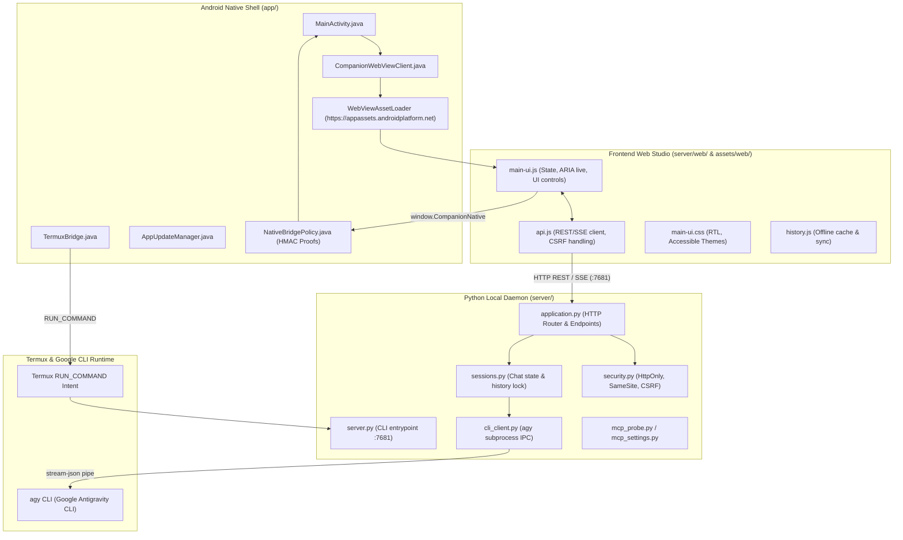

# Antigravity Companion: Codebase Architecture Map & Surgical Navigation Guide

> **Single Source of Truth**: This document maps 100% of the `antigravity-companion-app` codebase. Before touching any file, read this map to identify exact symbols, boundaries, and prescriptive modification recipes.

---

## 1. System Topology & Cross-Layer Data Flow

`Antigravity Companion` is a multi-tier hybrid application that bridges an Android native shell and accessible Web Studio to the local Google Antigravity CLI (`agy`) running in Termux.

### Architectural Diagram

### Core Communication Sequences

#### 1. Server Launch Sequence
1. **Trigger**: User opens Android App or taps "Start Server" toggle.
2. **Inspection**: `DoctorDiagnosticEngine.java` checks:
   - Is Termux installed (`com.termux`)?
   - Is `com.termux.permission.RUN_COMMAND` granted?
   - Is port `7681` already responding (`ServerConnection.java`)?
3. **Dispatch**: If not running, `TermuxBridge.java` sends a `RUN_COMMAND` intent to execute `server/launch_server.sh`.
4. **Daemonization**: `launch_server.sh` spawns `server/server.py --port 7681 --data-dir ~/.antigravity-companion` in the background and writes PID to `.server.pid`.
5. **Readiness Probe**: `MainActivity` polls `http://127.0.0.1:7681/api/status` until HTTP 200 is confirmed, then switches UI state to `ONLINE`.

#### 2. Chat Turn & Token Streaming Sequence
1. **User Input**: User submits a message via Web Studio (`main-ui.js`).
2. **REST Dispatch**: `api.js` issues `POST /api/chat` with JSON payload `{sessionId, prompt, model, reasoningEffort}`.
3. **Security Gate**: `security.py` verifies CSRF token, Session Cookie (`HttpOnly; SameSite=Strict`), and local `Origin` / `Host` headers.
4. **Session Lock**: `sessions.py` acquires the turn lock for the active session and appends the user turn.
5. **CLI Worker**: `cli_client.py` constructs flags and invokes `agy --print` or pipes to a warm stream-json subprocess.
6. **Streaming Egress**: Server streams Server-Sent Events (`text/event-stream`) back to `api.js`.
7. **Screen Reader Announcement**: `main-ui.js` updates live regions (`aria-live="polite"`), triggers WebAudio chimes, and handles speech synthesis if enabled.

#### 3. Native Bridge Security Protocol
- JavaScript invokes Android methods via `window.CompanionNative`.
- **HMAC Proof Guard**: Sensitive native calls (e.g., launching Termux commands, reading system state) require an HMAC proof generated using `NativeSecrets.java` and verified by `NativeBridgePolicy.java`.
- Prevents malicious external websites from triggering native actions if loaded in the WebView.

---

## 2. Component Breakdown & Responsibilities

The codebase is strictly segregated into 4 isolated tiers:

### Tier 1: Android Native Shell (`app/`)
* **Role**: Lightweight Android host providing the system container, WebView, Termux launcher, accessibility services integration, and background OTA updates.
* **Core Language**: Java 17 / Android SDK 34.
* **Package**: `com.antigravity.companion`.
* **Invariants**:
  - Zero heavy business logic; delegates AI and API orchestration to the Python server.
  - Strict Origin policies: only loads assets from `https://appassets.androidplatform.net/` or localhost `127.0.0.1:7681`.

### Tier 2: Python Backend Local Server (`server/`)
* **Role**: Local REST API and SSE streaming server running inside Termux.
* **Core Language**: Python 3.10+ (standard library `http.server` & lightweight concurrency).
* **Port**: `7681` (default).
* **Invariants**:
  - Bound exclusively to `127.0.0.1` (never exposed to public interfaces).
  - All state stored in local JSON/SQLite files under `--data-dir` (default: `~/.antigravity-companion`). Zero cloud database dependencies.

### Tier 3: Frontend Web Studio (`server/web/` & `app/src/main/assets/web/`)
* **Role**: Responsive, accessible Arabic RTL chat interface and diagnostics dashboard.
* **Core Tech**: Vanilla JavaScript (ES2022), CSS3, Semantic HTML5, Service Worker.
* **Invariants**:
  - **Dual-Copy Asset Invariant**: Canonical assets live in `server/web/`. Any changes MUST be mirrored to `app/src/main/assets/web/` using `python scripts/sync_android_web.py`.
  - Accessible to screen readers (TalkBack / Jieshuo): ARIA labels, semantic roles, high-contrast themes.

### Tier 4: Tooling, Packaging & Test Automation (`scripts/`)
* **Role**: Automated regression suites, release packaging, cryptographic signing, and environment preflight checks.
* **Core Language**: Python standard library (`unittest`), Bash, Java (ReleaseSigner).

---

## 3. File-by-File Matrix (Complete Inventory)

This matrix catalogs all production source files, their primary responsibilities, core exported symbols, and bidirectional dependencies.

### 3.1. Android Native Layer (`app/src/main/java/com/antigravity/companion/`)

| File | Core Responsibilities & Symbols | Dependencies In / Calling | Dependencies Out / Called By |
|---|---|---|---|
| `MainActivity.java` | Main Android Activity; manages lifecycle, initializes WebView, binds JavaScript native interface, handles back button, triggers background updates. Key symbols: `onCreate()`, `setupWebView()`, `checkAppUpdates()`, `initDiagnosticBanner()`. | Android OS, `CompanionWebViewClient`, `TermuxBridge`, `AppUpdateManager` | System launch intent |
| `CompanionWebViewClient.java` | Custom `WebViewClient` using `WebViewAssetLoader` to serve bundled assets securely; intercepts internal links, enforces origin validation. Key symbols: `shouldInterceptRequest()`, `shouldOverrideUrlLoading()`. | `OriginPolicy`, `WebViewAssetLoader` | `MainActivity` |
| `TermuxBridge.java` | Dispatches execution intents to Termux using `com.termux.RUN_COMMAND`; handles permission verification, background execution results, and socket probes. Key symbols: `launchServerIntent()`, `isTermuxInstalled()`, `hasRunCommandPermission()`. | `TermuxLaunchContract`, Android `Intent` | `MainActivity`, `DoctorDiagnosticEngine` |
| `DoctorDiagnosticEngine.java` | Performs comprehensive on-device health checks (Termux presence, RUN_COMMAND permission, local server responsiveness, battery optimization). Key symbols: `runAllDiagnostics()`, `DiagnosticResult`, `checkServerConnection()`. | `TermuxBridge`, `ServerConnection` | `MainActivity` |
| `AppUpdateManager.java` | Manages in-app OTA updates via GitHub Releases; checks version codes, downloads update APK via `UpdateTransfer`, validates checksums, triggers package installer. Key symbols: `checkForUpdate()`, `downloadAndInstall()`, `ReleaseInfo`. | `UpdatePolicy`, `UpdateCompatibility`, `UpdateTransfer` | `MainActivity` |
| `NativeBridgePolicy.java` | Security enforcement gate for JavaScript-to-Java calls exposed through `window.CompanionNative`; validates HMAC request proof tokens. Key symbols: `validateAction()`, `isAuthorizedCaller()`, `PolicyViolationException`. | `NativeProof`, `NativeSecrets`, `NativeRequestLedger` | `MainActivity` (JavaScript Interface) |
| `OriginPolicy.java` | Verifies allowed web origins (restricts to `https://appassets.androidplatform.net` and `http://127.0.0.1:7681`). Key symbols: `isAllowedOrigin()`, `sanitizeUrl()`. | Android Uri | `CompanionWebViewClient`, `NativeBridgePolicy` |
| `NativeSecrets.java` | Manages cryptographic session tokens and keystore-derived keys used to authenticate native bridge calls. Key symbols: `getSessionSecret()`, `deriveHmacKey()`. | Android Keystore | `NativeBridgePolicy`, `NativeProof` |
| `NativeRequestLedger.java` | Replay protection ledger; records nonce timestamps to prevent replay of intercepted native bridge calls. Key symbols: `recordNonce()`, `isNonceValid()`, `evictExpired()`. | Java Collections | `NativeBridgePolicy` |
| `NativeProof.java` | Validates HMAC-SHA256 signatures passed with native action invocations. Key symbols: `computeProof()`, `verifyProof()`. | `NativeSecrets`, `javax.crypto.Mac` | `NativeBridgePolicy` |
| `NativeActionArguments.java` | Deserializes and validates JSON arguments passed from JavaScript to native methods. Key symbols: `parseArguments()`, `getString()`, `getInt()`. | `org.json.JSONObject` | `MainActivity` |
| `ServerConnection.java` | HTTP ping client checking local server health on `127.0.0.1:7681/api/status`. Key symbols: `pingServer()`, `fetchStatus()`, `ConnectionCallback`. | `java.net.HttpURLConnection` | `DoctorDiagnosticEngine`, `MainActivity` |
| `TermuxLaunchContract.java` | Constant definitions and intent action/extra contracts for interacting with Termux. Key symbols: `ACTION_EXECUTE`, `EXTRA_COMMAND_PATH`, `EXTRA_ARGUMENTS`. | None | `TermuxBridge` |
| `UpdatePolicy.java` | Business rules determining whether a discovered GitHub release is compatible and eligible for auto-install. Key symbols: `shouldPromptUpdate()`, `isDowngradeProhibited()`. | `UpdateCompatibility` | `AppUpdateManager` |
| `UpdateCompatibility.java` | Checks Android SDK version compatibility and CPU architecture (arm64-v8a vs universal) for download candidate. Key symbols: `isCompatible()`, `getSupportedAbis()`. | Android `Build` | `UpdatePolicy`, `AppUpdateManager` |
| `UpdateTransfer.java` | File downloader streaming update APK bytes to isolated app storage with SHA256 verification. Key symbols: `downloadFile()`, `verifyChecksum()`. | `java.net.URL`, `java.security.MessageDigest` | `AppUpdateManager` |
| `BootReceiver.java` | Android BroadcastReceiver listening for `ACTION_BOOT_COMPLETED` to trigger optional background companion services. Key symbols: `onReceive()`. | Android `BroadcastReceiver` | Android OS |

---

### 3.2. Python Backend Server (`server/`)

| File | Core Responsibilities & Symbols | Dependencies In / Calling | Dependencies Out / Called By |
|---|---|---|---|
| `server.py` | CLI entry point and process lifecycle manager; parses `--host`, `--port`, `--data-dir`, binds HTTP server. Key symbols: `main()`, `run_server()`, `parse_args()`. | `application.py`, `launcher.py` | Shell / Termux `launch_server.sh` |
| `auth_flow.py` | Inspects and decodes Google Antigravity OAuth session tokens (`~/.gemini/antigravity-cli/antigravity-oauth-token`); checks email, expiration timestamp, and login validity. Key symbols: `get_oauth_token_info()`, `NAME`, `AUTH_TOKEN_FILE`. | `base64`, `json`, `pathlib` | `application.py` |
| `application.py` | Primary HTTP request router and endpoint controller; handles `/api/status`, `/api/chat`, `/api/sessions`, `/api/mcp`, `/api/doctor`, `/api/shutdown`. Key symbols: `CompanionRequestHandler`, `handle_chat()`, `handle_status()`, `dispatch_route()`. | `security.py`, `sessions.py`, `cli_client.py`, `runtime_status.py`, `mcp_probe.py` | `server.py` |
| `sessions.py` | Session management and state persistence; maintains chat conversation trees, history saves, and turn serialization locks. Key symbols: `SessionStore`, `get_session()`, `create_session()`, `append_turn()`, `acquire_turn_lock()`. | `storage.py`, `cli_client.py` | `application.py` |
| `cli_client.py` | Subprocess bridge and IPC coordinator to the Google `agy` CLI; formats model flags, reasoning effort, and stream-json pipes. Key symbols: `AgyCliClient`, `run_prompt_streaming()`, `discover_cli_path()`, `spawn_worker()`. | `cli_catalog.py`, `subprocess` | `sessions.py`, `application.py` |
| `cli_catalog.py` | Catalog of available Gemini models, alias mappings, reasoning capability flags, and default system instructions. Key symbols: `MODEL_CATALOG`, `resolve_model_alias()`, `get_model_capabilities()`. | None | `cli_client.py`, `cli_settings.py` |
| `cli_settings.py` | Reads and persists CLI user preferences, selected models, reasoning presets in `~/.antigravity-companion/settings.json`. Key symbols: `SettingsManager`, `load_settings()`, `save_settings()`. | `storage.py` | `application.py`, `cli_client.py` |
| `mcp_probe.py` | Dynamic discovery engine that inspects configured Model Context Protocol (MCP) servers and tools in `~/.gemini/antigravity-cli/mcp`. Key symbols: `probe_mcp_servers()`, `list_available_tools()`. | `pathlib`, `json` | `application.py`, `mcp_settings.py` |
| `mcp_settings.py` | Manages MCP tool enablement, server overrides, and authorization scopes. Key symbols: `get_mcp_config()`, `toggle_mcp_server()`. | `storage.py` | `application.py` |
| `runtime_status.py` | Gathers real-time server metrics (RAM usage, active sessions, child process health, Termux environment details). Key symbols: `get_runtime_status()`, `gather_system_metrics()`. | `psutil` (optional), `os`, `sys` | `application.py` |
| `security.py` | HTTP security boundaries; generates/verifies CSRF tokens, sets `HttpOnly; SameSite=Strict` cookies, validates Origin/Host headers. Key symbols: `verify_csrf_token()`, `generate_csrf_token()`, `validate_origin()`, `create_session_cookie()`. | `hmac`, `secrets`, `hashlib` | `application.py` |
| `storage.py` | Thread-safe file system storage helper; handles atomic JSON writes, schema migrations, and backup rotation under data-dir. Key symbols: `read_json()`, `write_json_atomic()`, `ensure_data_dirs()`. | `pathlib`, `tempfile` | `sessions.py`, `cli_settings.py` |
| `launcher.py` | Background process daemonizer and PID file manager; supports start, stop, status checks from CLI. Key symbols: `start_daemon()`, `stop_daemon()`, `is_running()`, `read_pid()`. | `os`, `signal` | `server.py`, `launch_server.sh` |
| `local_tasks.py` | In-memory job coordinator for long-running background tasks (e.g., deep transcript downloads, batch exports). Key symbols: `TaskManager`, `enqueue_task()`, `get_task_status()`. | `threading`, `queue` | `application.py`, `task_runtime.py` |
| `task_runtime.py` | Execution sandbox for local background tasks with timeout guards and cancellation signals. Key symbols: `TaskWorker`, `execute_with_timeout()`. | `local_tasks.py` | `application.py` |
| `voice_agent.py` | Voice session orchestrator coordinating speech recognition and text-to-speech synthesis pipelines. Key symbols: `VoiceAgent`, `process_voice_turn()`. | `voice_planner.py` | `application.py` |
| `voice_planner.py` | Natural language intent parser for voice commands (e.g. "open chat", "start diagnostic", "read screen"). Key symbols: `VoicePlanner`, `plan_action()`. | `re`, `json` | `voice_agent.py` |
| `android_client.py` | Direct Termux-to-Android helper; executes `am start` and Android broadcast commands if Termux:API is present. Key symbols: `send_broadcast()`, `launch_activity()`. | `subprocess` | `application.py` |
| `legacy_conversations.py` | Data migration adapter converting legacy JSON chat history into the modern session format. Key symbols: `import_legacy_chats()`, `adapt_history_schema()`. | `storage.py` | `sessions.py` |
| `version.json` | JSON metadata defining current server release name, semantic version, build timestamp, and Git commit SHA. | Read by `application.py` | Diagnostic endpoints |
| `launch_server.sh` | Shell script launching the daemonized Python server in Termux; redirects logs to `~/.antigravity-companion/server.log`. | Spawns `server.py` | Termux `RUN_COMMAND` |
| `stop_server.sh` | Shell script stopping the running daemon by sending `SIGTERM` to the PID recorded in `.server.pid`. | Uses `kill` | Termux `RUN_COMMAND`, `MainActivity` |

---

### 3.3. Frontend Web Studio (`server/web/` & `app/src/main/assets/web/`)

> [!IMPORTANT]
> **Dual-Copy Invariant**: `server/web/` is the canonical source. Whenever any file here is modified, you MUST run `python scripts/sync_android_web.py` to copy changes into `app/src/main/assets/web/`.

| File | Core Responsibilities & Symbols | Interacting Files |
|---|---|---|
| `index.html` | Core responsive single-page interface; contains chat message stream, prompt textarea, reasoning effort toggles, model selector, diagnostic drawer, and ARIA live regions for screen readers. | `main-ui.css`, `main-ui.js`, `api.js` |
| `start.html` | First-run / fallback onboarding page displayed when server is offline or initializing. | `main-ui.css`, `CompanionNative` |
| `main-ui.js` | UI state controller; manages message DOM rendering, markdown formatting, auto-scrolling, accessibility focus traps, keyboard shortcuts (`Ctrl+Enter`), and WebAudio feedback. | `index.html`, `api.js`, `history.js` |
| `main-ui.css` | Accessible CSS design system; RTL layouts, high contrast dark/light themes, WCAG AA compliant contrast ratios, fluid responsiveness. | `index.html`, `start.html` |
| `api.js` | Asynchronous REST and SSE client; manages HTTP session tokens, CSRF handshakes, message chunk parsing, and reconnection retries. Key symbols: `sendMessageStream()`, `fetchStatus()`, `fetchSessions()`. | `main-ui.js`, Backend `application.py` |
| `history.js` | Client-side IndexedDB / LocalStorage cache for offline conversation browsing and search. | `main-ui.js` |
| `manifest.json` | Progressive Web App (PWA) manifest; defines theme colors, app icons, and standalone display mode. | Browser / WebView |
| `sw.js` | Service Worker; caches static shell assets (`css`, `js`, `svg`) while bypassing API endpoints (`/api/*`). | Browser / PWA runtime |
| `icon.svg` | Scalable vector logo for Antigravity Companion. | `manifest.json`, `index.html` |

---

### 3.4. Tooling, Packaging & Test Automation (`scripts/`)

| File | Purpose and Core Symbols | Invariants & Test Coverage |
|---|---|---|
| `doctor.py` | CLI diagnostic utility (`python scripts/doctor.py --doctor`); inspects Python, Termux environment, `agy` on PATH, server status. | Read-only inspection; run anytime. |
| `sync_android_web.py` | Canonical asset synchronizer (`python scripts/sync_android_web.py [--check]`); copies `server/web/` to `app/src/main/assets/web/` and verifies MD5 parity. | Essential pre-commit check. |
| `prepare_web_release.py` | Updates cache version hashes inside `sw.js` before release builds. | Run before packaging releases. |
| `package_release.py` | Builds signed production Termux ZIP packages with cryptographic signatures. | Requires release keys. |
| `install_release.py` | Verifies and selects Termux package releases atomically with rollback protection. | Used by update orchestrator. |
| `ReleaseSigner.java` | Java cryptographic utility for RSA/ECDSA signing of release manifests. | Run via JDK. |
| `phase1_preflight.py` | Preflight suite testing CLI `--help` flags, argument parsing, and local HTTP endpoint readiness. | Required CI/Preflight gate. |
| `run_tests.py` | Main test runner discovering all unit and integration suites under `scripts/`. | Python standard `unittest`. |
| `run_backend_tests.py` | Comprehensive test suite for `application.py`, `sessions.py`, `security.py`, and `storage.py`. | 60+ test cases. |
| `run_android_web_asset_tests.py` | Validates parity between canonical web assets and Android bundled assets. | Checks hashes. |
| `run_auth_tests.py` | Tests CSRF validation, session cookie handling, and Origin policy enforcement. | Security gate. |
| `run_feature_tests.py` | End-to-end chat turn and SSE streaming tests against mock CLI runners. | Feature gate. |
| `run_launcher_tests.py` | Tests PID file management, daemon spawning, and signal handling. | Process management. |
| `run_mcp_scope_tests.py` | Tests MCP server discovery, schema extraction, and tool execution scopes. | MCP integration. |
| `run_parity_tests.py` | Regression tests checking behavioral parity between local and remote models. | Parity verification. |
| `test_code_map_integrity.py` | Automated integrity test for `CODE_MAP.md`; verifies sections, recipes, and 100% file indexing. | Self-referential test gate. |
