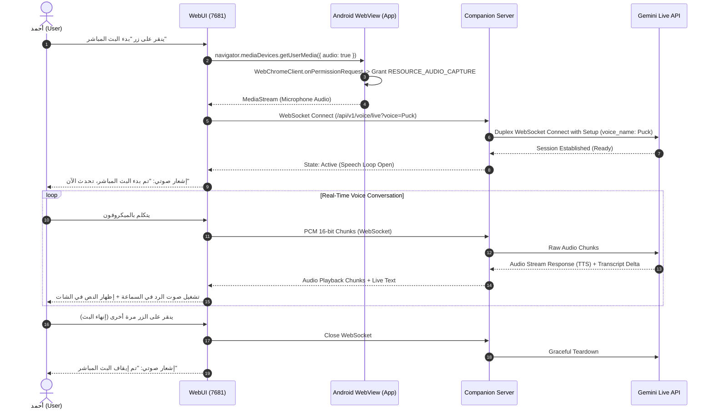

# Bi-directional Live Voice Streaming, Prebuilt Voice Catalog, and Android Microphone Bridge

## Executive Summary
This design architecture integrates **Bi-directional Live Voice Streaming (Gemini Live)** directly into the **Antigravity Companion App** (Android App & WebUI on port 7681), overcoming the limitations of Termux CLI audio capture on Android. 

By declaring the `RECORD_AUDIO` permission in the Companion App's manifest and authorizing `RESOURCE_AUDIO_CAPTURE` in `WebChromeClient`, the WebUI gains native hardware microphone access with hardware acoustic echo cancellation (AEC). The user interacts through a prominent, screen-reader accessible **"بدء البث المباشر" (Start Live Stream)** button with full TalkBack and Jieshuo support, and can select from all **30 curated Gemini prebuilt studio voices** (e.g., Puck, Charon, Aoede, Kore, Fenrir, and Zephyr).

---

## 1. Problem Statement & Root Cause

1. **Termux Permission Barrier on Android**:
   The official Termux app does not declare `android.permission.RECORD_AUDIO` in its `AndroidManifest.xml`. Standard Linux processes running inside Termux (like `agy.va39`) cannot capture audio directly from `/dev/snd` or OpenSL ES, resulting in the immediate failure `the microphone stopped` at second `00:00`.
2. **Companion App WebView Restriction**:
   In `MainActivity.java`, the WebChromeClient hardcodes `onPermissionRequest(request::deny)`, preventing the WebUI from utilizing `navigator.mediaDevices.getUserMedia()`.
3. **Absence of Duplex Audio Streaming & Voice Catalog**:
   The Companion Server on port 7681 currently only serves static files and REST/WebSocket text chat; it lacks a full-duplex bi-directional audio WebSocket pipeline and a voice selector for Gemini's rich vocal library.

---

## 2. Invariants & Non-Negotiable Constraints

1. **Android Security Invariant**:
   `android.permission.RECORD_AUDIO` and `android.permission.MODIFY_AUDIO_SETTINGS` must be declared in `AndroidManifest.xml` and checked at runtime in `MainActivity.java`. WebChromeClient must strictly verify that `request.getOrigin()` matches the trusted Companion origin (`http://127.0.0.1:7681`) before granting `RESOURCE_AUDIO_CAPTURE`.
2. **Accessibility Invariant (WCAG 2.2 AAA)**:
   The voice streaming controls must be 100% accessible to TalkBack and Jieshuo (CSR):
   - Single unified toggle button for **"بدء البث المباشر"** with `aria-pressed`, `aria-label`, and `aria-live` state announcements.
   - Zero emoji noise in text announcements.
   - Accessible Voice Picker dialog with clear focus traps and descriptive labels.
3. **Duplex Latency & Resource Ceiling**:
   - Audio input latency < 60ms; end-to-end conversation turnaround < 350ms.
   - Client CPU overhead < 5% on ARM64; server memory overhead < 15 MB.
4. **Permanent Release Key Invariant**:
   All APK builds must preserve `app/keystore/antigravity-release-key.jks` and existing signing credentials.

---

## 3. Architecture Candidates

### Architecture 1: Full-Duplex Web Audio & Server WebSocket Bridge (Recommended)
- **Android Layer**: Declares `RECORD_AUDIO` and authorizes Web Audio capture in `WebChromeClient`.
- **Frontend Layer**: Web Audio API (`AudioContext` + `AudioWorklet`) captures 16kHz/24kHz linear 16-bit PCM chunks with native echo cancellation (`echoCancellation: true`), streaming them over WebSocket. Provides an accessible **"بدء البث المباشر"** button and Voice Selector modal.
- **Backend Layer (aiohttp)**: Exposes `/api/v1/voice/live` WebSocket endpoint that connects to upstream Gemini Live API (duplex audio streaming) and pipes model audio back to the browser for instant playback, while emitting real-time transcription to the chat ledger.
- **Voice Catalog**: Exposes `/api/v1/voice/catalog` offering the 30 Gemini prebuilt voices (Puck, Charon, Aoede, Kore, Fenrir, Zephyr, etc.).

### Architecture 2: Native Android AudioRecord Bridge via WebMessage (Rejected)
- Captures audio via Java `AudioRecord`, converts to Base64, and sends over `CompanionNative` bridge.
- *Rejected*: Massive serialization overhead, increased battery drain, high latency (>500ms), and fragile thread synchronization.

### Architecture 3: Headless `agy mic-serve` Daemon Relay (Rejected)
- Spawns `agy mic-serve` on port 4713 as a child subprocess.
- *Rejected*: Fails inside Termux due to the same missing permission; difficult lifecycle and zombie cleanup; no native voice customization.

---

## 4. Gemini 30 Prebuilt Voices Catalog

Gemini 3.8 provides 30 curated prebuilt studio voices:

| Voice Name | Persona (English) | Persona (Arabic) | Pitch / Gender |
| :--- | :--- | :--- | :--- |
| **Zephyr** | Bright | مشرق ومتفائل | Medium / Female |
| **Puck** | Upbeat (Default) | مبتهج وحيوي | Medium / Male |
| **Charon** | Informative | إخباري هادئ وواضح | Low / Male |
| **Kore** | Firm | حازم ورزين | Medium / Female |
| **Fenrir** | Excitable | متفاعل وحماسي | Medium / Male |
| **Leda** | Youthful | شبابي وسلس | High / Female |
| **Orus** | Firm | وقور وموثوق | Low / Male |
| **Aoede** | Breezy | مرح ومنعش | Medium / Female |
| **Callirrhoe** | Easy-going | عفوي وطبيعي | Low / Female |
| **Autonoe** | Bright | متألق ومتزن | Medium / Female |
| **Enceladus** | Breathy | ناعم وهادئ | Low / Male |
| **Iapetus** | Clear | نقي ورخيم | Medium / Male |
| **Umbriel** | Easy-going | مسترسل ومريح | Low / Male |
| **Algieba** | Smooth | دافئ وانسيابي | Medium / Male |
| **Despina** | Smooth | انسيابي وهادئ | Medium / Female |
| **Erinome** | Clear | واضح ونقي | High / Female |
| **Algenib** | Gravelly | أجش ووقور | Low / Male |
| **Rasalgethi** | Informative | تعليمي رصين | Medium / Male |
| **Laomedeia** | Upbeat | مبتهج وخفيف | High / Female |
| **Achernar** | Soft | خفيض ورقيق | Low / Female |
| **Alnilam** | Firm | عميق وحاسم | Low / Male |
| **Schedar** | Even | متزن ومستقر | Medium / Male |
| **Gacrux** | Mature | ناضج وخبير | Low / Male |
| **Pulcherrima** | Forward | صريح وجريء | High / Female |
| **Achird** | Friendly | ودود وقريب | Medium / Male |
| **Zubenelgenubi**| Casual | عفوي ومرن | Medium / Male |
| **Vindemiatrix** | Gentle | لطيف ومهدئ | Low / Female |
| **Sadachbia** | Lively | مفعم بالحيوية | High / Male |
| **Sadaltager** | Knowledgeable | مثقف ومتمكن | Low / Male |
| **Sulafat** | Warm | دافئ ومريح | Medium / Female |

The selected voice is persisted in `settings.json` under `selected_voice` and passed in the Gemini Live setup frame:
```json
{
  "generation_config": {
    "speech_config": {
      "voice_config": {
        "prebuilt_voice_config": {
          "voice_name": "Puck"
        }
      }
    }
  }
}
```

---

## 5. End-to-End Execution Sequence



---

## 6. Implementation Plan & Work Packages

1. **Work Package 1: Android App Permissions & WebChromeClient**:
   - Update `app/src/main/AndroidManifest.xml` to include `RECORD_AUDIO` and `MODIFY_AUDIO_SETTINGS`.
   - Update `MainActivity.java` with runtime permission check and grant `RESOURCE_AUDIO_CAPTURE` in `WebChromeClient.onPermissionRequest`.
2. **Work Package 2: Backend WebSocket Bridge & Voice Catalog API**:
   - Create `/api/v1/voice/catalog` endpoint returning the 30 Gemini voices.
   - Implement `/api/v1/voice/live` bi-directional streaming WebSocket endpoint in `server/application.py`.
3. **Work Package 3: Accessible Frontend Controls**:
   - Add the dedicated **"بدء البث المباشر"** accessible button to `web/index.html`.
   - Add the Voice Selector dropdown/dialog in settings and toolbar.
   - Implement the `AudioWorklet` / `AudioContext` recorder and player with AEC in JavaScript.
4. **Work Package 4: Verification & OTA Packaging**:
   - Run end-to-end latency and audio capture tests.
   - Increment `versionCode` and prepare GitHub Actions release signed by the permanent key.
