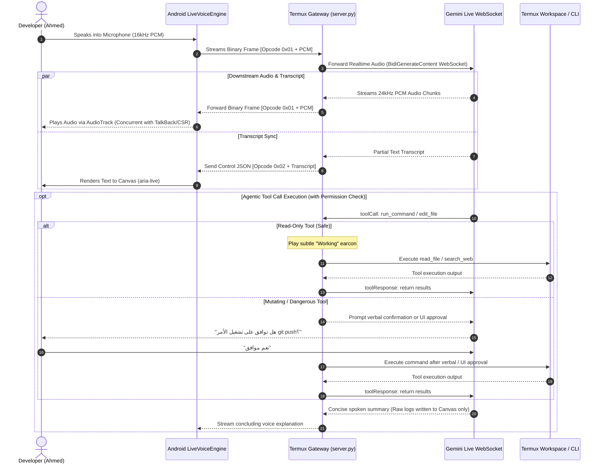

# Native Live Voice Mode Design Document

* **Author:** ahanafy41
* **Date:** 2026-11-05
* **Status:** Finalized (Post EGM Multi-Lens Review)

---

## 1. The Problem

The Antigravity Companion App currently operates exclusively via text-driven turns and visual or screen-reader interactions within its WebUI canvas. When interacting on mobile devices or in hands-free scenarios (e.g., walking, rapid prototyping, multitasking, or blind navigation via TalkBack/Jieshuo), text typing imposes cognitive and physical friction:

1. **High Turn Latency**: Typing code questions or review instructions on a mobile software keyboard is slow and prone to input errors.
2. **Missing Realtime Multimodal Cadence**: Standard LLM text request-response models take 3 to 8 seconds to deliver a full turn, lacking conversational immediacy, natural emotional cadence, and the ability to interrupt the assistant mid-sentence.
3. **Screen Reader Audio Collision**: Conventional text-to-speech (TTS) engines or media players seize exclusive Android audio focus (`AUDIOFOCUS_GAIN`), abruptly pausing or muting TalkBack or Jieshuo speech streams. This disorients visually impaired developers who need their screen reader active while collaborating.
4. **Isolated Audio Prototypes**: Generic speech-to-text tools cannot execute agentic tools or inspect the local Termux workspace during the call, turning voice into a detached dictation toy rather than a true development partner.

---

## 2. Overview

Native Live Voice Mode integrates full-duplex, sub-second conversational speech directly into the Antigravity Companion App. It connects the Android companion interface to the Google Gemini Multimodal Live API via the local Termux backend gateway (`127.0.0.1:7681`). 

Developers can speak naturally in Egyptian Arabic or English, hear immediate, expressive AI audio responses, interrupt at any point, and watch the agent inspect workspace files, run bash commands, and execute tests in real time while continuing the dialogue. The system preserves absolute screen-reader independence using non-blocking audio focus routing and updates the companion chat canvas atomically on every utterance.

---

## 3. Goals and Non-Goals

### Goals
* **Sub-Second Conversational Latency**: Stream raw 16kHz PCM audio upstream and 24kHz PCM audio downstream with roundtrip time under 800ms.
* **Full Barge-in (Interruption) Support**: Instantly halt AI speech and adjust context the moment user speech is detected, without losing conversation continuity.
* **Concurrent Audio Architecture**: Route AI audio through `STREAM_MUSIC` with non-blocking audio focus (`AUDIOFOCUS_GAIN_TRANSIENT_MAY_DUCK`), guaranteeing zero interruption to `STREAM_ACCESSIBILITY` (TalkBack) and configurable concurrent playback for Jieshuo/CSR.
* **Human-Gated Tool Execution**: Safe autonomous tool execution where read-only tools run silently, while mutating/destructive commands require explicit voice or UI approval.
* **Dual-Surface Canvas Sync**: Transcribe both user speech and model output in real time into the existing chat canvas and persistent session store (`sessions.py`).
* **Non-Visual Auditory Earcons**: Provide distinct procedural audio tones for mic open, barge-in mute, background tool computation, and network degradation.

### Non-Goals
> [!IMPORTANT]
> **Architectural Invariants & Non-Goals:**
> * **No AccessibilityService Resurrection**: Do not reintroduce the retired Android AccessibilityService or port 8765 daemon; all operations remain strictly within the lean companion web/native harness.
> * **No Direct Cloud Bypassing**: Do not connect the Android phone directly to cloud endpoints; Termux must remain the stateful local gateway to maintain tool execution and security guarantees.
> * **No Canvas Replacement**: Voice mode does not replace the visual/screen-reader chat canvas; it operates as an integrated parallel input/output modality.

---

## 4. Technical Plan

### 4.1 High-Level Architecture & Wire Framing Contract

The Native Live Voice subsystem employs a three-tier streaming topology designed for ultra-low latency, robust mobile audio hardware integration, and secure local tool execution.

#### Wire Framing Specification (`ws://127.0.0.1:7681/api/v1/voice/live`)
To cleanly separate raw binary audio from structured events without JSON serialization overhead:
* **Binary Frame Format**:
  * `Byte 0x00`: Protocol Magic Byte (`0xAA`).
  * `Byte 0x01`: Opcode:
    * `0x01`: Raw Audio Payload (Little-Endian PCM). Upstream = 16kHz, Downstream = 24kHz.
    * `0x02`: Control / Event Payload (UTF-8 JSON text containing transcripts, earcons, tool requests).
  * `Bytes 0x02..`: Payload bytes.

---

### 4.2 Component Breakdown

#### A. Android Native Layer (`com.antigravity.companion.LiveVoiceEngine`)
* **Audio Capture (`AudioRecord`)**:
  * Sampling rate: 16,000 Hz, 16-bit Linear PCM, Mono channel.
  * Frame duration: 80 ms per frame (1,280 samples / 2,560 bytes).
  * Hardware AEC: Instantiates `android.media.audiofx.AcousticEchoCanceler` attached to the recording audio session ID if supported.
  * **Software Feedback Gate (Anti False-Barge-in)**:
    When playing audio through device loudspeakers (headset disconnected), the software engine raises the speech detection threshold by +12dB during active playback to prevent speaker bleed from cutting off AI speech.
* **Audio Playback (`AudioTrack`)**:
  * Sampling rate: 24,000 Hz, 16-bit Linear PCM, Mono channel.
  * Audio Attributes: `USAGE_MEDIA` with `CONTENT_TYPE_SPEECH`.
  * **Screen Reader Coexistence Setting**: Supports standard transient ducking (`AUDIOFOCUS_GAIN_TRANSIENT_MAY_DUCK`) and a toggle for "Concurrent Playback" ensuring Jieshuo (CSR) on `STREAM_MUSIC` is never silenced.
* **Foreground Audio Service**:
  * Declares `FOREGROUND_SERVICE_MICROPHONE` in `AndroidManifest.xml` to prevent Android 14 (API 34) process suspension when switching between Termux, browser, and companion.
* **Procedural Non-Visual Earcon Parameters**:
  * `CONNECT`: Dual-frequency sine sweep (440Hz -> 880Hz, duration: 80ms, fade-in 10ms, fade-out 10ms).
  * `MUTE` (Barge-in): Short soft tick (800Hz, duration: 25ms, rapid decay).
  * `TICK` (Background Working): Periodic subtle low pulse (500Hz, duration: 30ms, volume: 20%, interval: 2.5s).
  * `ERROR` (Network Drop): Descending alert sweep (600Hz -> 250Hz, duration: 150ms).

#### B. Termux Gateway Layer (`server/live_voice.py` & `server/application.py`)
* **WebSocket Endpoint**: `GET /api/v1/voice/live?session_id={id}`
* **Upstream Live Connection**:
  * Connects to Google's Gemini Multimodal Live WebSocket:
    `wss://generativelanguage.googleapis.com/ws/google.ai.generativelanguage.v1beta.GenerativeService.BidiGenerateContent`
  * Passes Google OAuth Bearer Token loaded from `~/.gemini/antigravity-cli/antigravity-oauth-token`.
* **Human-Gated Tool Calling**:
  * Read-only actions (`read_file`, `search_web`, `read_url_content`) execute immediately.
  * Mutating actions (`run_command`, `write_file`, `edit_file`) require verbal confirmation ("نعم/موافق") or UI approval.
* **Concise Spoken Summaries (Cognitive Fatigue Guard)**:
  * System prompt instructs the model: *"Summarize terminal and tool outputs in at most 2 natural sentences for voice. Never read long raw logs aloud; full logs are streamed to the screen-reader canvas."*
* **Voice Activity Idle Guard**:
  * Monitors audio frames; if silence persists for 45 seconds, enters standby and pauses upstream socket transmission.

#### C. Companion WebUI Layer (`server/web/native.js` & `server/web/main-ui.js`)
* **Bridge Communication**:
  * Uses the established `CompanionNative` bridge via `postMessage` protocol:
    `CompanionNative.postMessage(JSON.stringify({ action: "toggleLiveVoice" }))`
* **Accessible Toggle Button & Announcer**:
  * Header button `#live-voice-toggle` with concise ARIA label:
    `aria-label="محادثة صوتية: بدء"` (switches dynamically to `إيقاف`).
  * Live status announcer: `#voice-live-announcer` (`aria-live="polite"`).
* **Live Transcript Feed**:
  * Renders streaming transcript bubbles in real time with high contrast and proper screen-reader heading structure.
  * Persists completed conversational turns through `Sessions.record_turn()` and `AtomicStore`.

---

## 5. Alternatives Considered

### Alternative 1: Browser-Based Web Speech API (STT & TTS in WebView)
* **Description**: Utilizing standard browser APIs (`webkitSpeechRecognition` and `window.speechSynthesis`) directly inside the Companion WebView.
* **Status**: Rejected by author and architects.
* **Rationale**:
  1. *Unacceptable Turn Latency*: Web speech recognition requires a complete utterance boundary before dispatching text, incurring a 2 to 4 second roundtrip delay.
  2. *Lack of Affective Cadence*: Standard Android TTS voices sound mechanical and robotic compared to the native expressive Gemini Live audio models.
  3. *No True Barge-in*: The model cannot be interrupted mid-sentence based on acoustic signals.
  4. *Background Suspension*: Android WebViews pause Web Speech processing as soon as the screen turns off or the user switches apps.

### Alternative 2: Direct Android-to-Cloud WebSocket Connection (Bypassing Termux)
* **Description**: Establishing the Gemini Live WebSocket directly from the Android Kotlin/Java layer to Google Cloud, completely bypassing the Termux server on port 7681.
* **Status**: Rejected by architects.
* **Rationale**:
  1. *Severed Tool Execution*: The AI model must inspect code, run tests, read git status, and invoke MCP servers residing in the Termux Linux environment. If Android connects directly to the cloud, executing a Termux command would require a clumsy secondary reverse-tunnel back into Termux.
  2. *Security Boundary Violation*: Keeping Termux as the sole authenticated gateway ensures that existing credential protection, token isolation, and workspace sandbox policies remain strictly enforced.

### Alternative 3: Exclusive Audio Focus Seizure (`AUDIOFOCUS_GAIN`)
* **Description**: Requesting exclusive audio focus when the AI speaks to silence all other device sounds.
* **Status**: Rejected by author.
* **Rationale**:
  * Silencing other audio streams would mute or pause `STREAM_ACCESSIBILITY`, abruptly interrupting TalkBack and Jieshuo screen readers. For blind developers, losing screen-reader speech creates immediate disorientation. The architecture must strictly mandate concurrent transient ducking (`AUDIOFOCUS_GAIN_TRANSIENT_MAY_DUCK`).

### Alternative 4: Third-Party WebRTC Native Audio Stack (C++ NDK Engine)
* **Description**: Compiling and embedding the full Google WebRTC library into the Android companion app.
* **Status**: Rejected by architects.
* **Rationale**:
  * Adds over 40 MB of compiled native `.so` binaries, significantly bloating the lean companion package. Native Android `AudioRecord` and `AudioTrack` APIs handle 16kHz/24kHz raw PCM streaming cleanly over local loopback using less than 32 KB/s of bandwidth with negligible CPU footprint.

---

## 6. Detailed Implementation Plan

### 6.1 Affected Files & Rationale

| File Path | Action | Rationale |
| :--- | :--- | :--- |
| `server/live_voice.py` | Create | Implements the core Termux streaming multiplexer. Connects to Google's Gemini Multimodal Live WebSocket via OAuth, streams 16kHz PCM upstream, receives 24kHz PCM downstream, enforces verbal tool confirmations, and guards against silence timeouts. |
| `server/application.py` | Modify | Registers the WebSocket endpoint `GET /api/v1/voice/live` within the aiohttp application router and ensures cookie/pairing authentication checks apply to voice streaming sessions. |
| `app/src/main/java/com/antigravity/companion/LiveVoiceEngine.java` | Create | Native Android audio manager. Handles continuous `AudioRecord` capture (16kHz PCM), hardware/software echo cancellation, low-latency `AudioTrack` streaming (24kHz PCM), procedural earcons, and concurrent audio focus. |
| `app/src/main/java/com/antigravity/companion/MainActivity.java` | Modify | Registers `toggleLiveVoice` on existing `CompanionNative` bridge, initiates `LiveVoiceEngine`, and requests runtime audio and foreground service permissions. |
| `app/src/main/AndroidManifest.xml` | Modify | Declares required Android audio permissions: `RECORD_AUDIO`, `MODIFY_AUDIO_SETTINGS`, and `FOREGROUND_SERVICE_MICROPHONE`. |
| `server/web/index.html` | Modify | Adds the accessible `#live-voice-toggle` button in the header and the dedicated `#voice-live-announcer` (`aria-live="polite"`) element for screen-reader announcements. |
| `server/web/main-ui.js` & `server/web/native.js` | Modify | Handles the UI state machine, dispatches commands via `CompanionNative.postMessage`, renders streaming transcript chunks into the chat view, and updates button accessibility attributes. |
| `server/sessions.py` | Modify | Uses `AtomicStore` mutation handlers to persist completed spoken user prompts and assistant responses directly into session state. |
| `tests/test_live_voice.py` | Create | Automated unit test suite verifying WebSocket framing, mock Gemini Live message parsing, tool execution dispatching, and disconnection reconnection logic. |
| `project_spec.json` | Modify | Registers the new Live Voice capability and updates the project specification metadata. |

---

### 6.2 Implementation Phases & Sequencing

#### Phase 1: Termux Live Gateway Engine (`server/live_voice.py` & `server/application.py`)
1. Implement the WebSocket handler in `server/live_voice.py` reading client binary frames (`0xAA 0x01` PCM / `0xAA 0x02` JSON).
2. Load the Google OAuth Bearer token from `~/.gemini/antigravity-cli/antigravity-oauth-token` and negotiate the upstream Live WebSocket session.
3. Configure the session `setup` frame specifying:
   * Modalities: `["AUDIO"]`
   * Audio Output Config: `voiceName: "Puck"` (or configurable between the 8 verified personas).
   * Tool Declarations: Export Antigravity tools (`run_command`, `read_file`, `edit_file`, `search_web`).
   * Cognitive Guard: Instruct model to produce concise verbal summaries while full logs stream to text.
4. Wire the human-gated tool dispatcher: read-only tools run silently; mutating tools require confirmation before dispatching to Termux.
5. Implement the 45-second silence timeout monitor to close upstream connections when idle.

#### Phase 2: Native Android Audio Engine (`LiveVoiceEngine.java`)
1. Create `LiveVoiceEngine.java` in the Android companion app package.
2. Initialize `AudioRecord` at 16,000 Hz, 16-bit Mono, with a 1,280-sample circular buffer.
3. Check and attach `android.media.audiofx.AcousticEchoCanceler` and implement software energy gating during playback.
4. Initialize `AudioTrack` at 24,000 Hz, 16-bit Mono, with concurrent playback settings.
5. Connect native audio streams directly to Termux loopback WebSocket (`ws://127.0.0.1:7681/api/v1/voice/live`).
6. Implement the non-visual procedural tone generator for connection, barge-in, background tick, and error earcons.

#### Phase 3: WebUI Integration & Dual-Surface Canvas Sync
1. Inject the Live Voice toggle button into `server/web/index.html` with explicit RTL Arabic labels and keyboard focus outlines.
2. Connect the button click in `server/web/native.js` and `server/web/main-ui.js` using `CompanionNative.postMessage`.
3. Stream partial transcript text from the WebSocket directly into active chat bubbles in the UI.
4. Commit finalized turn objects through `sessions.py` and `AtomicStore`.

#### Phase 4: Rigorous Quality, A11y & Security Verification
1. Run automated test suite: `pytest tests/test_live_voice.py`.
2. Verify with TalkBack and Jieshuo: ensure screen reader speech is never interrupted while the AI assistant speaks.
3. Verify Acoustic Echo Cancellation: confirm that loudspeaker playback does not trigger self-barge-in loops.
4. Run security audit: verify zero token leakage, strict loopback binding on `127.0.0.1`, and robust validation of all incoming audio frames.
